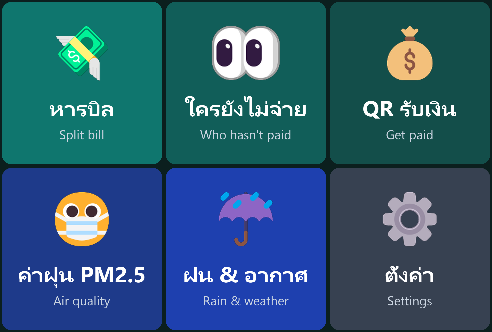

# 🙏 Khun Chuay (คุณช่วย): a LINE bot for everyday life in Thailand

**Split the bill with friends using PromptPay QR codes, and get PM2.5 + rain alerts for exactly where you are, inside the LINE app everyone in Thailand already uses.**

No app to install and no website. Add the bot as a friend or drop it into your group chat. It runs free on Cloudflare's edge network, and answers in Thai or English depending on how you write to it.

---

## 📱 No commands to remember: just tap



A button menu sits under the chat. Tapping **💸 หารบิล** starts a short conversation:

```
🤖 💸 ยอดรวมทั้งบิลเท่าไหร่?                    you: 1850
🤖 หาร ฿1,850 กี่คน?  [2 คน][3 คน][4 คน]…      you tap: 4 คน
🤖 มีค่าเซอร์วิสหรือ VAT?  [ไม่มี][VAT 7%][เซอร์วิส 10%][เซอร์วิส+VAT]   tap
🤖 💸 คนละ ฿544.37  + PromptPay QR
```
First time? It asks for your PromptPay number before the bill and remembers it after that. In group chats (where LINE shows no menu) the same conversation starts by typing **หารบิล**. Only the person who started it can answer, and dinner chatter in between is ignored. Fast typers can still use one-line shortcuts like `หาร 1850 4 vat sc`.

## 💸 Split bills with PromptPay

```
Aom:   หาร 1,850 4 คน vat sc

🤖 ┌──────────────────────────────┐
   │ 💸 หารบิล                     │
   │ คนละ ฿544.37                  │
   │ 4 คน · จ่ายให้ Aom             │
   │ [ PromptPay QR, amount set ] │
   │ ยอดอาหาร          ฿1,850     │
   │ เซอร์วิส 10%         ฿185     │
   │ VAT 7%            ฿142.45    │
   │ รวม             ฿2,177.45    │
   │ [ ✅ ฉันจ่ายแล้ว ] [ 👀 ใครจ่ายแล้วบ้าง ] │
   └──────────────────────────────┘
Mai taps ✅  →  🤖 ✅ Mai จ่ายแล้ว (2/4)
Ton taps ✅  →  🤖 ✅ Ton จ่ายแล้ว (3/4)
Aom:   ใครยังไม่จ่าย  →  🤖 ⏳ ยังเหลืออีก 1 คน (รวม ฿544.37)
```

- **Real PromptPay QR codes** that any Thai banking app can scan, with the amount already filled in. The QR is **generated inside the bot** (EMVCo payload + CRC16 + a hand-written PNG encoder), so no third-party QR service ever sees anyone's phone number.
- Thai restaurant maths: **service charge 10% first, then VAT 7% on top**. Calculations are done in satang (whole numbers), and shares are rounded *up*, so the payer is never short.
- **Payment tracking** with buttons: who has paid, how much is still owed, and 🎉 when everyone's done.
- Understands how people actually type: `หาร 1850 4`, `หาร1,850 4คน vat`, `แชร์ 900 3 ภาษี`, `split ฿2,400.50 3 people +10%`.
- `qr 500` gives a quick PromptPay QR to receive ฿500 (handy for selling things).
- PromptPay ID set once per person (`ตั้งพร้อมเพย์ 081…`) and works in every group. It's shown masked (`081-xxx-5678`).

## 😷 PM2.5 + ☔ rain where you are

```
(shares location near Siam)
🤖 😷 ฝุ่น PM2.5 ใกล้คุณ
   🔵 12 µg/m³ · ดีมาก
   📍 สถานีสำนักงานเขตราชเทวี กรุงเทพฯ (1.4 กม.) · 00:00 น.
   💡 อากาศดีมาก ออกไปข้างนอกได้สบาย
   📈 คาดว่าจะแย่ลงถึง ~20 ช่วง 12:00 น.

   🌦 ฝนและอากาศ
   ☀️ ไม่น่ามีฝนใน 12 ชม.ข้างหน้า
   🌡 26°C รู้สึกเหมือน 28°C
```
*(Real output from live data.)*

- **Real measurements** from the nearest of Thailand's ~170 official Pollution Control Department stations, using **Thailand's own PM2.5 bands** (🔵 ≤15, 🟢 ≤25, 🟡 ≤37.5, 🟠 ≤75, 🔴 >75 µg/m³) with advice to match.
- Forecasts: PM2.5 getting worse later today, rain windows ("☔ 80% chance 17:00–19:00, take an umbrella"), feels-like temperature and heat warnings.
- `แจ้งเตือน 7` sends a **morning summary every day at 7:00**. `เตือนฝน` warns you **before rain arrives**.
- Works anywhere in Thailand (Bangkok, Chiang Mai, Phuket...), in private chats and in groups.

---

## Try it in 30 seconds (no accounts needed)

Double-click **`Try Khun Chuay.cmd`**, or:
```bash
npm install
npm run try
```
This runs the real bot code in a simulated LINE chat with live air/weather data. Press **1–6** for the menu buttons and **a, b, c…** for the buttons under a message. QR codes open as images you can scan with your banking app. Switch to a group chat with `/group` and play a friend with `/me Mai`.

## Put it on LINE (free, about 10 minutes)
See **[SETUP.md](SETUP.md)**. In short: create a LINE channel, then run `npm run setup`.

---

## How it works

```
 LINE app ──▶ LINE platform ──webhook (signed)──▶ Cloudflare Worker ──▶ Cloudflare KV
                     ▲                              │   │                (PromptPay IDs,
                     └──── reply / push ────────────┘   │                 bills, locations,
                                                        │                 alert subscriptions)
                          Air4Thai (PCD stations) ◀─────┤
                          Open-Meteo (rain, heat,  ◀────┘
                          PM2.5 forecast)            ⏰ hourly cron → morning summaries + rain alerts
```

| File | What it does |
|---|---|
| [`src/promptpay.js`](src/promptpay.js) | PromptPay / EMVCo payload, CRC-16/CCITT, Thai national-ID checksum, masking |
| [`src/qrpng.js`](src/qrpng.js) | QR matrix → PNG, with CRC32 and zlib done by hand (no image library) |
| [`src/bill.js`](src/bill.js) | Thai/English command parsing, satang-exact split maths |
| [`src/air.js`](src/air.js) | Station feed, nearest station (haversine), Thai PM2.5 bands, rain windows, heat |
| [`src/app.js`](src/app.js) | The bot: routing, bills, payment tracking, alerts, scheduled jobs, HTTP |
| [`src/line.js`](src/line.js) | LINE webhook signature check (HMAC-SHA256, constant-time), reply/push/profile |
| [`src/messages.js`](src/messages.js) | Every reply in Thai + English, Flex message cards, quick-reply buttons |
| [`src/richmenu.js`](src/richmenu.js) | The button menu's layout (3 × 2 grid, each button "types" a message) |
| [`scripts/try.mjs`](scripts/try.mjs) | LINE chat simulator with tappable buttons |
| [`scripts/setup.mjs`](scripts/setup.mjs) | One-command deploy, including the button menu |
| [`scripts/richmenu.mjs`](scripts/richmenu.mjs) · [`make-richmenu-image.py`](scripts/make-richmenu-image.py) | Installs the menu via the LINE API · draws its image |

## Testing

```bash
npm test          # 21 tests: units + full conversations through the real HTTP handler
npm run test:qr   # scans generated QR codes with OpenCV and re-checks every field + CRC in Python
```

The end-to-end tests send **signed webhooks** into the real request handler and walk through whole journeys: a group splits a bill with VAT + service charge, friends tap "paid" (including double taps and the payer tapping their own bill), forged webhooks are rejected, tampered QR links get 403, the morning schedule fires once while the rain alert respects its 6-hour cool-down, a brand-new user splits a bill purely by tapping, group chatter and other people's taps can't hijack someone's half-finished split, and every menu button is pressed to check it leads somewhere useful.

QR codes are verified **independently**: a different QR reader (OpenCV) scans the PNGs, and a separate EMVCo parser and CRC implementation (Python's `binascii.crc_hqx`) check the result. That way the code isn't just agreeing with itself. The bot was also run in Cloudflare's own runtime (`wrangler dev` / workerd) and checked endpoint by endpoint.

## Engineering notes

- **The government air server has a broken certificate chain.** It sends a Let's Encrypt certificate followed by an unrelated Sectigo intermediate, so strict TLS clients (Node, possibly Cloudflare) refuse it, while browsers on Windows quietly repair it. The bot treats station data as "best available": if the feed fails, or the nearest reading is more than 30 km away or older than 3 hours, it switches to the CAMS air-quality model (via Open-Meteo) and **labels it as an estimate** instead of presenting old or distant data as "now". Both paths are tested.
- **Privacy:** QR images are rendered by the bot itself rather than an external QR API, and the image links are HMAC-signed so the endpoint can't be used to generate arbitrary codes.
- **Fits Cloudflare's free plan:** outgoing requests per scheduled run are budgeted (the free plan allows 50), users within about 1 km share a single forecast request, and the 135 KB station list is cached for 15 minutes.
- **No spam in groups:** the bot only speaks when it's spoken to with a command.
- **Conversation state** is a tiny per-person, per-chat record in KV that expires after 10 minutes, so an abandoned split never gets stuck. Any new command simply replaces it.

## Limits and ideas

- LINE's free plan includes a limited number of **push** messages per month, and a push to a group counts once per member. Replies to messages are free. Daily alerts suit personal chats more than big groups.
- Splits are equal. Next: uneven splits ("Mai had 2 beers") and a weekly "who still owes me" reminder.

Built with JavaScript on Cloudflare Workers. Free data: [Air4Thai](https://air4thai.pcd.go.th) (Pollution Control Department), [Open-Meteo](https://open-meteo.com) (CC BY 4.0). QR generation: [qrcode-generator](https://github.com/kazuhikoarase/qrcode-generator) (MIT).
